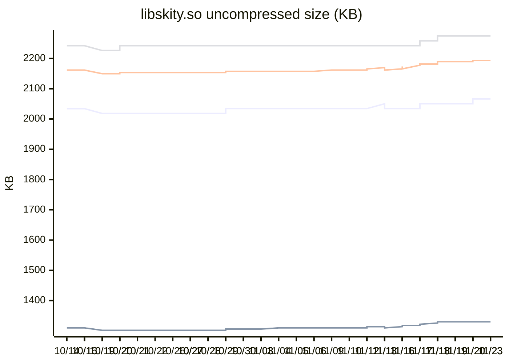
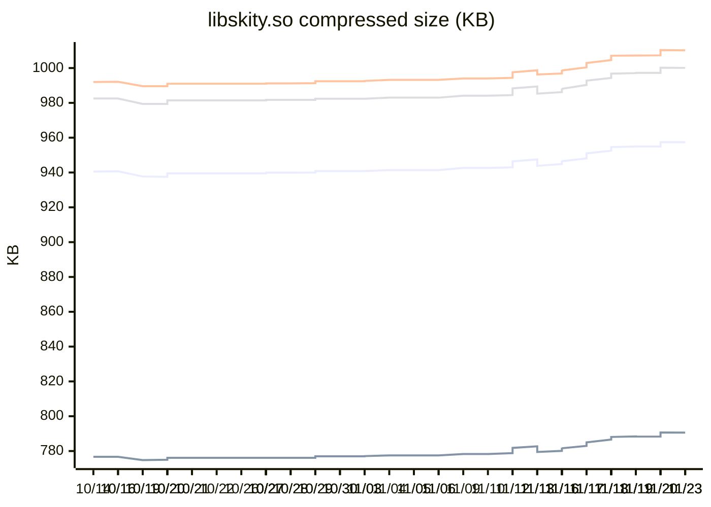

# skity binary size trend

> This branch is updated automatically by CI; do not edit manually.

## Latest snapshot

| ABI | Uncompressed | Compressed |
|---|---:|---:|
| arm64-v8a | 2.02 MB | 957.4 KB |
| armeabi-v7a | 1.30 MB | 790.6 KB |
| x86 | 2.14 MB | 1010.2 KB |
| x86_64 | 2.22 MB | 1000.1 KB |

Latest commit: `f510322736`

## Uncompressed size trend

## Compressed size trend

