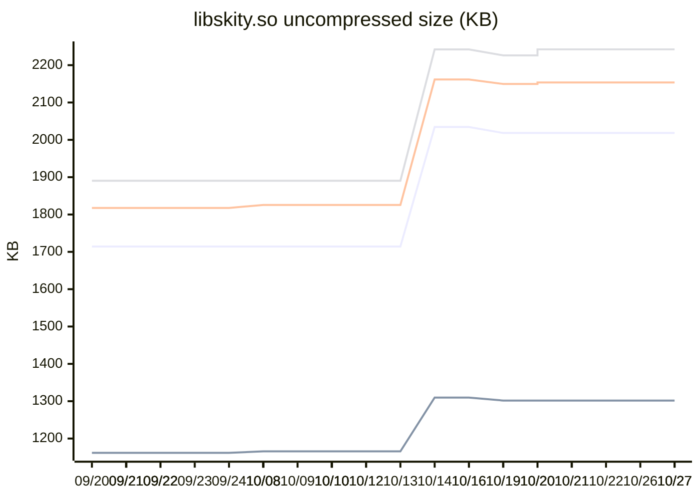
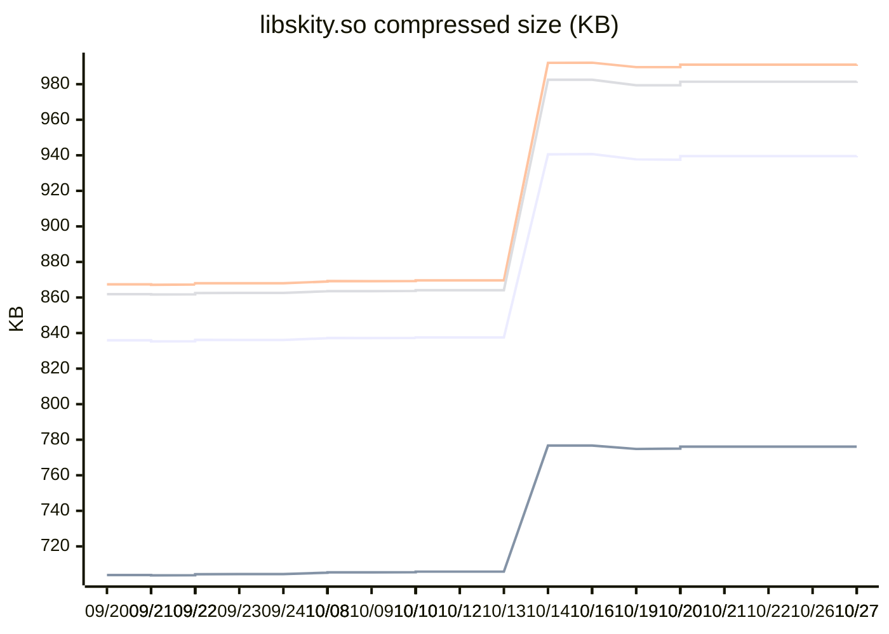

# skity binary size trend

> This branch is updated automatically by CI; do not edit manually.

## Latest snapshot

| ABI | Uncompressed | Compressed |
|---|---:|---:|
| arm64-v8a | 1.97 MB | 939.6 KB |
| armeabi-v7a | 1.27 MB | 776.1 KB |
| x86 | 2.10 MB | 991.1 KB |
| x86_64 | 2.19 MB | 981.5 KB |

Latest commit: `fd0ea8441b`

## Uncompressed size trend

## Compressed size trend

